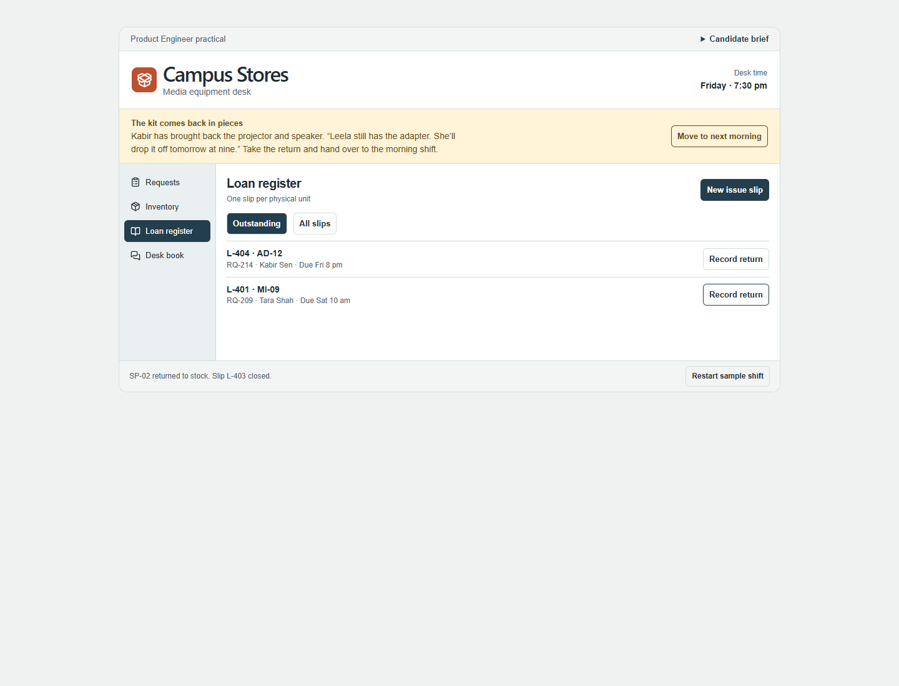
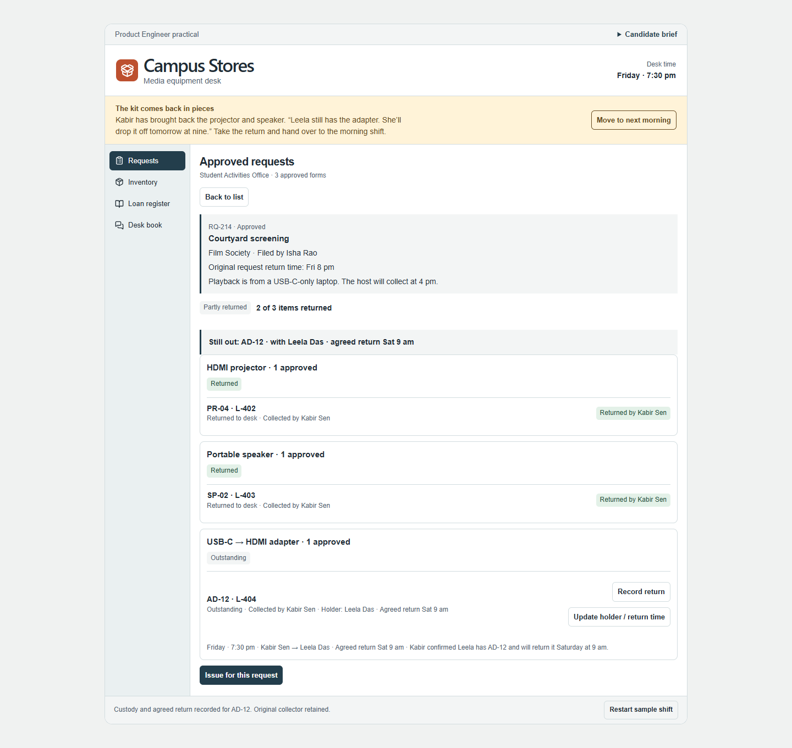
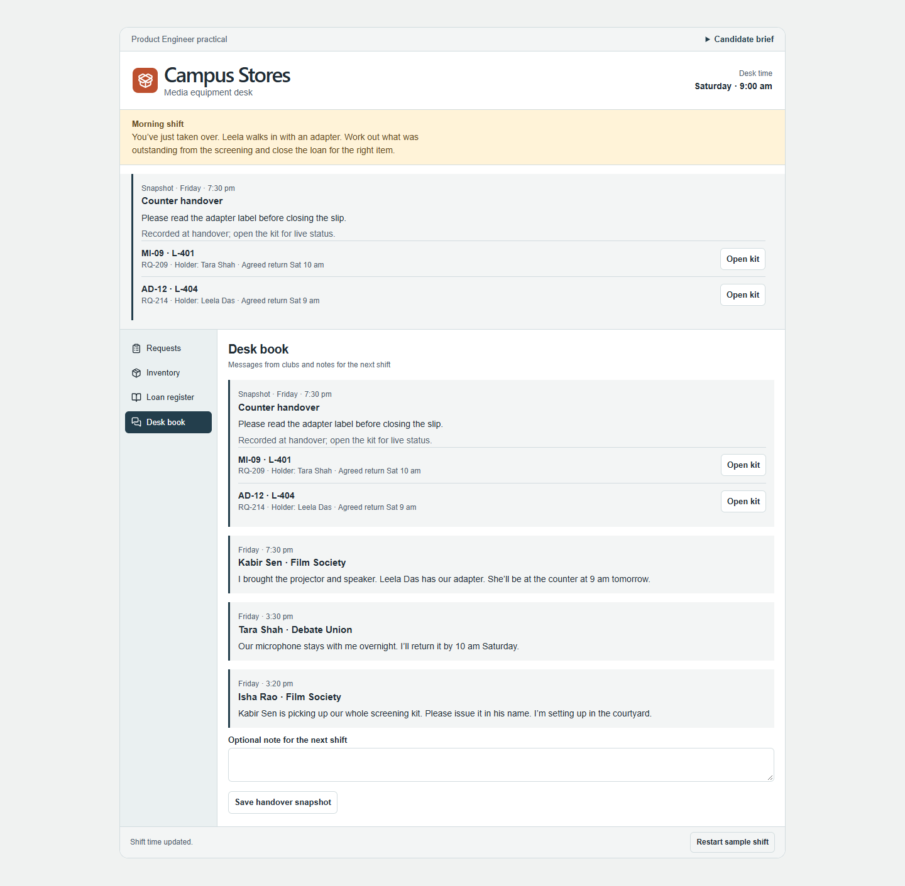
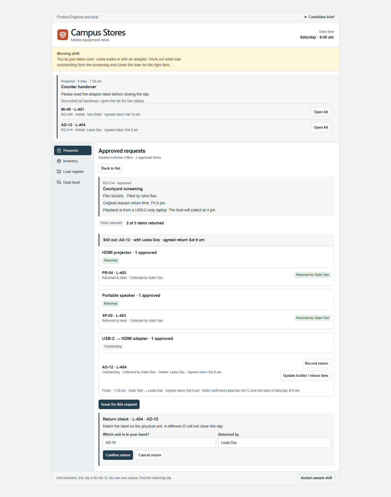

# Campus Stores — a kit can come back in pieces

A focused Product Engineer assessment prototype for the campus media equipment desk.

**Decision:** keep the existing product and its per-unit loan records, but make partial returns and next-shift handovers understandable from the approved request. The morning clerk should not need to reconstruct who has the last adapter from unrelated slips and messages.

## Start reviewing here

- **[Product decision and original-shift evidence](docs/DECISION.md)** — one moment that works, one to change, the proposed flow, trade-offs, and one real-counter observation to validate it.
- **[Verification notes](docs/VERIFICATION.md)** — executed checks, results, and boundaries.
- **Working prototype:** open `index.html`. No install, build, server, or internet connection is needed.

| Original evening register | Improved request-level kit |
|---|---|
|  |  |

## Walk through the same job

1. Click **Restart sample shift** for a clean start. In **Desk book**, read Isha's message authorizing Kabir to collect the screening kit.
2. In **Requests**, open Film Society's **View kit**. Use **Issue for this request** to issue PR-04, SP-02, and AD-12 individually to Kabir Sen. The request and original Friday 8 pm return time are prefilled. Use the shortcut again for each unit; the existing per-unit checks remain.
3. Click **Move to return time**. Open the Film Society kit and **Record return** for PR-04 and SP-02. Enter the physical unit ID and Kabir as the returner, then confirm each return.
4. For AD-12, choose **Update holder / return time**. Set Leela Das, Saturday 9 am, and record Kabir's confirmation as the reason. Kabir remains the original collector; the custody agreement is visible in the kit.
5. The kit now says **Partly returned**, **2 of 3 items returned**, and names AD-12, Leela, and the agreed return time together.
6. In **Desk book**, optionally add a note and **Save handover snapshot**. It automatically includes outstanding physical units and their current holders and return arrangements.
7. Click **Move to next morning**. The previous-shift snapshot appears above the screens, with an **Open kit** link. It is labelled as a historical snapshot, not live loan state.
8. Open Film Society's kit and return AD-12 as Leela. First try AD-15: the mismatch is rejected and no loan closes. Enter AD-12 to finish. Film Society becomes **Complete**, while Debate Union's MI-09 stays outstanding.





## Run locally

Open `index.html` in a modern browser, or serve this directory:

```sh
python3 -m http.server 8000 --bind 127.0.0.1
```

Then visit `http://localhost:8000`. Each browser/origin saves its own fictional sample shift when storage is available. Old v1 saved shifts migrate to v2; malformed state falls back to the sample. **Restart sample shift** restores the starting records.

## Tests

Runtime requires no dependencies. Development checks:

```sh
node --test tests/kit.test.cjs
node --check app.js
node --check kit-model.js
```

For the real-browser scenario, with Chrome installed:

```sh
uv run --with playwright python tests/browser-check.py
```

The browser check uses the installed Chrome executable on Windows; change its executable path for another machine. It regenerates the after screenshots and JSON evidence. No Playwright package is shipped to application users.

## Scope and source

- `app.js`: sample records, screen rendering, issue/return/custody/handover interactions, persistence.
- `kit-model.js`: pure request progress derivation, loaded by a normal script tag for offline use.
- `index.html`, `styles.css`: original four-screen shell with focused responsive additions.
- `tests/`: regression checks and repeatable browser walkthrough.
- `docs/evidence/`: original and improved workflow screenshots and machine-readable results.

This remains a single-browser prototype, not a multi-user asset-management backend. It records a clerk's custody agreement; it does not independently verify authorization or possession. Return times remain scenario labels rather than a real overdue clock. Bulk kit issue, scanning, and notifications are deliberately out of scope. `TASKS.md` is the pre-existing broader backlog, not a completed-feature checklist.

Bundled icon notices: [Lucide license](third-party/lucide-LICENSE.txt).

## Original assessment submission instructions

Push the completed work to a public fork of [virinchi-healthcare/campus-stores](https://github.com/virinchi-healthcare/campus-stores). Submit the final **commit URL**, roll number, and email through the [assessment Google Form](https://docs.google.com/forms/d/e/1FAIpQLScvzoh1R4WS-SkiwAVBQbMvniieJYSoOEfLMyVo5CyjOvYUgQ/viewform). Roll number and email belong in the form only, not this repository. The form has not been submitted automatically.
