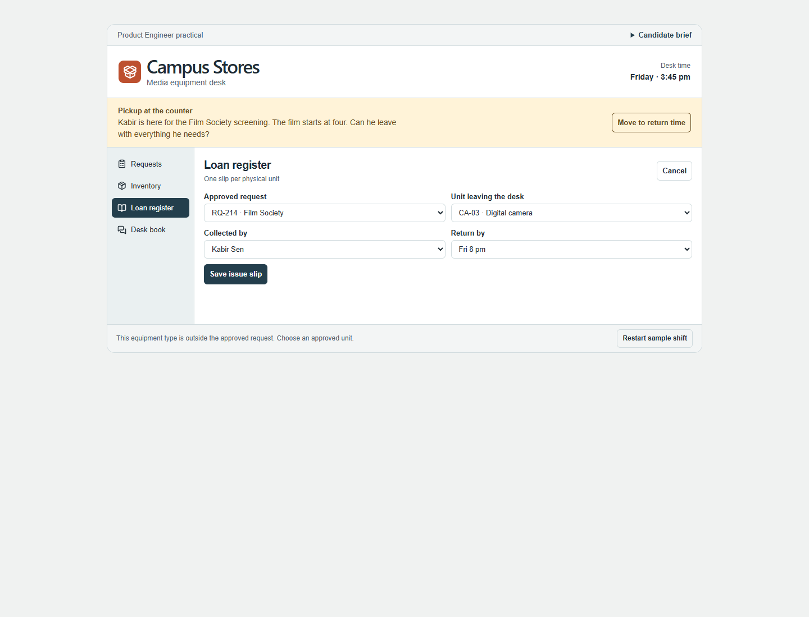
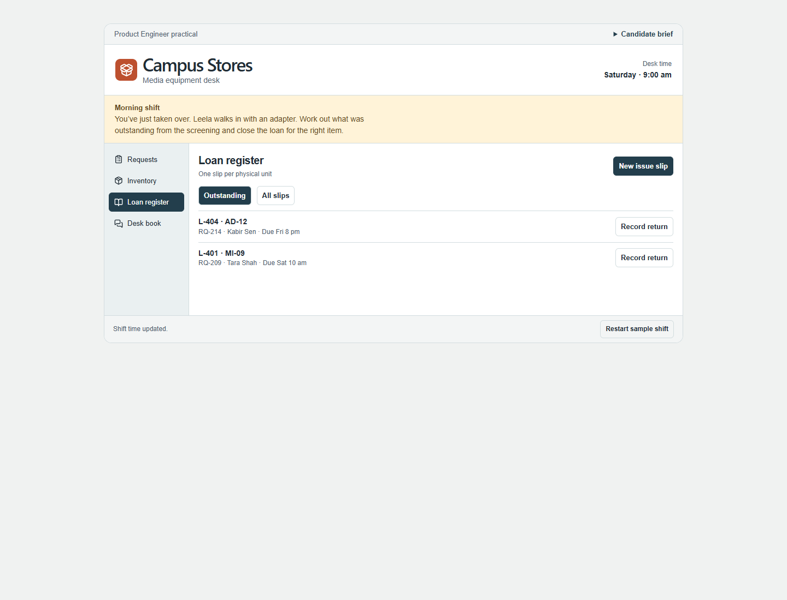

# A kit can come back in pieces

## Decision

Keep Campus Stores, but make the approved request the place to understand a kit's return. Keep individual slips underneath: the counter still lends and receives physical units, not abstract quantities.

The change is focused on one problem: **after a partial return, the next clerk needs to know what is still out, who holds it, and which physical unit to receive.**

## Evidence from the original shift

I walked the original sample through pickup, evening return, and the following morning in Chrome using its real forms. These are observations from the fictional exercise, not research at a real counter.

### A moment worth keeping: enforcing the approved equipment

I selected Film Society request RQ-214 and tried issuing camera CA-03. The form refused with “This equipment type is outside the approved request. Choose an approved unit.” The request authorizes a projector, speaker, and USB-C adapter—not a camera. This is a useful guardrail when the counter is busy. Units in repair and already-out units are also excluded from the issue options.

### A moment to change: the evening return does not describe the remaining job

I issued PR-04, SP-02, and AD-12 to Kabir Sen, with Friday 8 pm as the return time. At Friday 7:30 pm I returned PR-04 and SP-02. The register correctly left AD-12 outstanding, but its slip still named Kabir and Friday 8 pm. The story says Leela has the adapter and will bring it Saturday at 9 am. That information lives in a separate Desk book message, not on the loan.

To make the next shift aware of this, I manually copied the request, unit IDs, remaining holder, and expected return into a free-text handover note. The next morning the loan register still named Kabir. “Record return” closed the slip immediately without asking which physical adapter arrived or who returned it.

The problem is not that the app loses every record. It retains the individual slips and the club message. The problem is that the clerk has to assemble them into the answer to a simple question: **what remains of this kit?**

## Proposed flow

1. Open Film Society's request and see its approved equipment alongside the linked physical units.
2. Issue the equipment using the existing per-unit checks.
3. In the evening, return the projector and speaker. The request now describes a partly returned kit, not three unrelated slips.
4. Record that AD-12 passed to Leela, keeping Kabir as the original collector and retaining a reason/history. Record the agreed Saturday 9 am return separately from the custody change.
5. Save a generated handover snapshot that includes open units, current holders, and return arrangements. Add a short human note if needed.
6. Next morning, open the linked request, identify AD-12 on the item in hand, and record Leela as the returner. An AD-15 entry must not silently close AD-12's slip.
7. Film Society becomes complete. Debate Union's MI-09 remains outstanding; finishing one club's job must not close another's loan.

## What stays

- **Physical unit IDs and one slip per unit.** Two similar adapters are not interchangeable records.
- **Approval and availability checks.** A faster interface must not permit an unauthorized equipment type or double lending.
- **The four-screen structure.** Existing users can still use Requests, Inventory, Loan register, and Desk book.
- **Desk book messages.** They are useful context; linked structured information complements them rather than pretending every conversation can be a form.
- **Offline, no-build use.** This assessment does not need a backend, account system, or framework migration.

## Trade-offs and boundaries

This is a single-browser prototype. It cannot synchronize two counters or independently verify that a custody claim is true. A recorded handoff is a clerk's acknowledgement, not proof of physical possession. A saved handover is a point-in-time snapshot; current loan state remains the source for subsequent returns.

The prototype deliberately does not automatically substitute a different physical unit when the returned ID disagrees with the slip. It stops closure and asks the clerk to investigate. Quietly rewriting asset history would make the records look tidy while concealing a possible mix-up.

Bulk issuance, barcode scanning, notifications, and backend multi-user access are outside this focused change. The existing TASKS.md is a broader backlog, not a claim that every item was implemented.

## One observation at a real counter

At morning handover, observe whether the incoming clerk can correctly identify **the outstanding physical unit, its current holder, and its agreed return time without consulting another record or asking the outgoing clerk**. Record success and time-to-answer for partial-return jobs before and after the change over comparable shifts. Check the physical unit against the eventual return, not just whether the UI was clicked quickly.

This would test the actual hypothesis: the request-level summary reduces reconstruction work without increasing wrong-unit closures. No real-counter improvement or percentage gain has been measured here.
